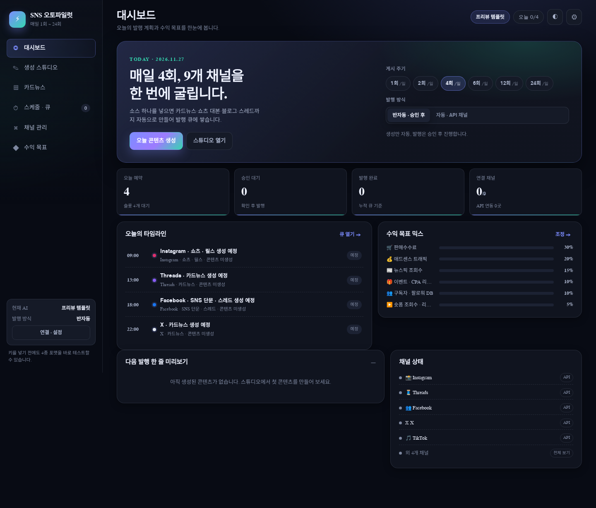
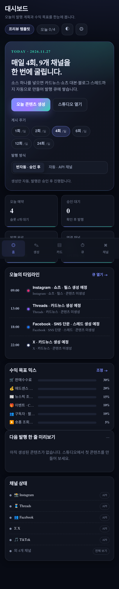
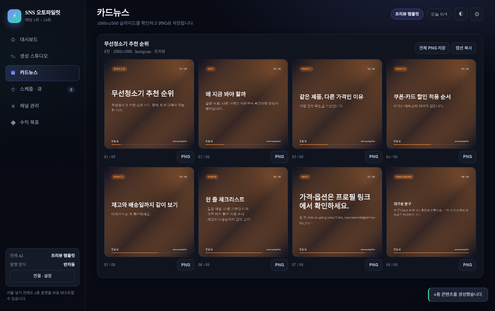
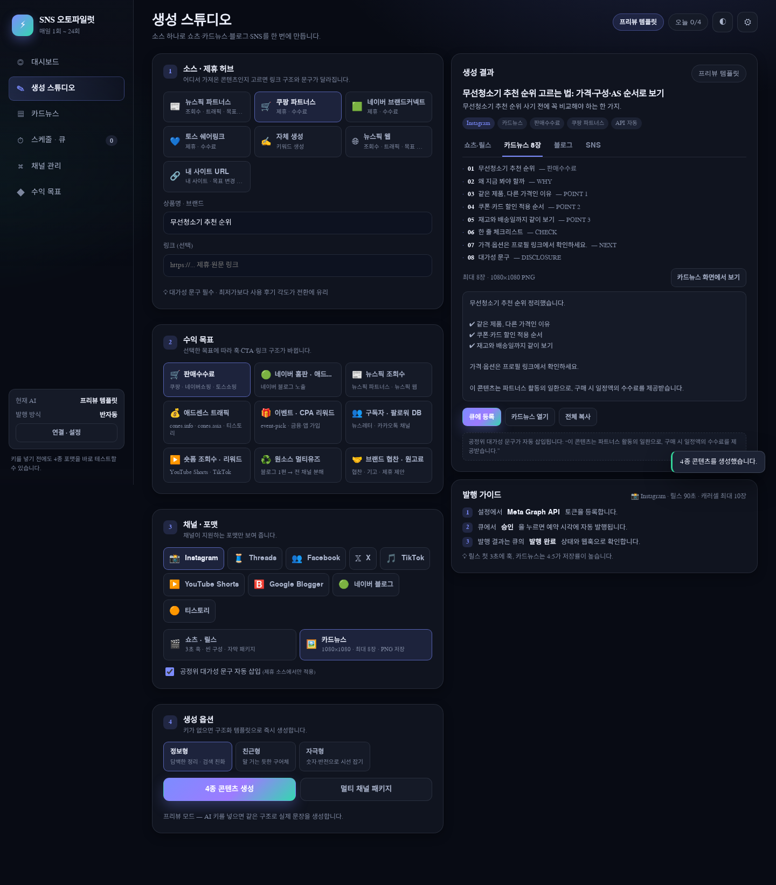
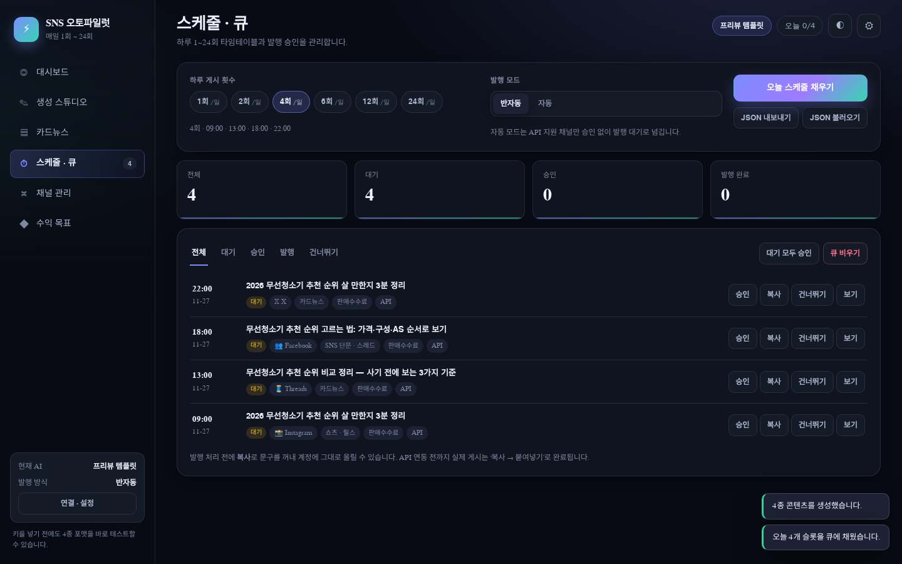
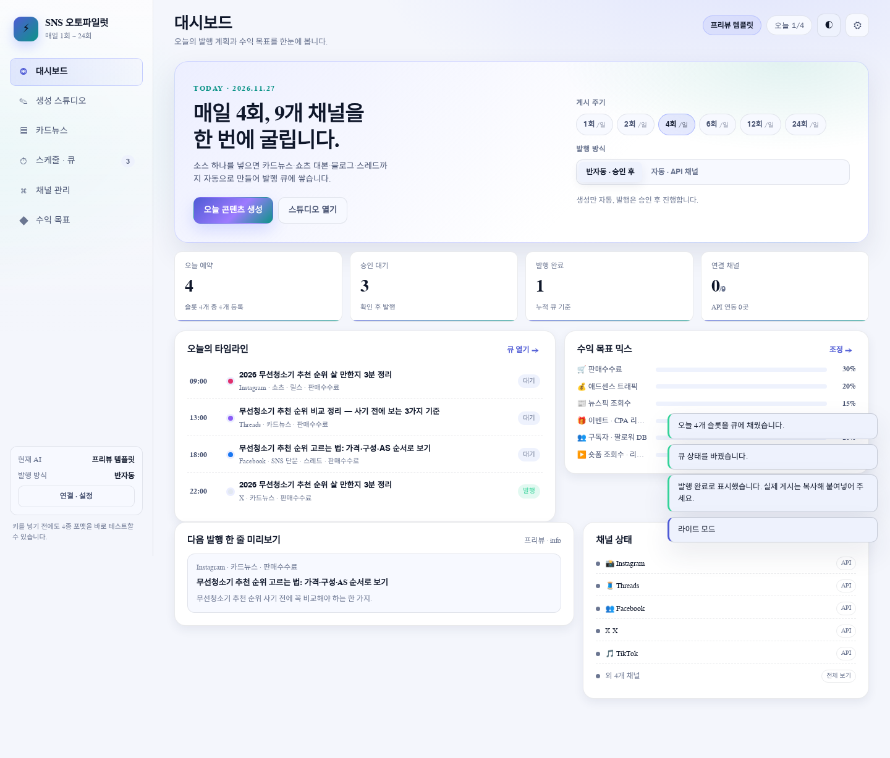

# SNS 오토파일럿 (SNS Autopilot) v1.0.0

매일 **1회 ~ 24회**, **9개 채널**에 올릴 콘텐츠를 한 곳에서 만들고 발행 큐까지 관리하는 SNS 자동화 스튜디오입니다.
소스 하나(뉴스픽·쿠팡파트너스·브랜드커넥트·토스·내 사이트·키워드)를 넣으면 **쇼츠 대본 · 카드뉴스(1080×1080) · 블로그 HTML · SNS 단문/스레드** 4종을 한 번에 만들고, 하루 타임테이블에 맞춰 큐에 쌓습니다.

- **라이브**: https://sns-autopilot.pages.dev (Cloudflare Pages)
- **저장소**: `hijun67/261127-sns-autopilot`
- **만든 날**: 2026-11-27 (KST)

## 화면

| 데스크톱 1440px | 모바일 390px | 카드뉴스 |
|---|---|---|
|  |  |  |

| 생성 스튜디오 | 스케줄 · 큐 | 라이트 모드 |
|---|---|---|
|  |  |  |

## 1단계에서 되는 것

### 1. 게시 채널 9곳
| 채널 | 지원 포맷 | API | 비고 |
|---|---|---|---|
| Instagram | 릴스 · 카드뉴스 | Meta Graph API | Business/Creator 계정 |
| Threads | 스레드 · 카드뉴스 | Threads API | 500자 |
| Facebook | 피드 · 카드뉴스 | Meta Graph API | 페이지 단위 |
| X | 트윗/스레드 · 카드뉴스 | X API v2 | 280자 · 무료 플랜 쓰기 한도 작음 |
| TikTok | 쇼츠 | Content Posting API | 심사 필요 |
| YouTube Shorts | 쇼츠 | Data API v3 | 업로드 1건 1,600 units |
| Google Blogger | 블로그 | Blogger API v3 | `cones.asia` 등 HTML 원문 |
| 네이버 블로그 | 블로그 | **공식 글쓰기 API 종료** | 원클릭 복사 → 스마트에디터 |
| 티스토리 | 블로그 | **공식 글쓰기 API 종료** | 원클릭 복사 → HTML 모드 |

### 2. 콘텐츠 4종 자동 생성
- **쇼츠·릴스**: 3초 훅 + 6씬(타임코드·화면·나레이션·자막) + 캡션 + 썸네일 문구
- **카드뉴스**: 최대 8장, 브라우저 Canvas로 1080×1080 렌더링, 장별 PNG 저장(전체 저장 지원)
- **블로그**: SEO 제목·메타 설명·소제목·표·FAQ·HTML(인라인 스타일 없이 Blogger 호환) + 텍스트 복사
- **SNS**: X 스레드(각 280자 이내 자동 절삭) · Threads · Facebook 본문

### 3. 수익화·운영 목표 9종
판매수수료(쿠팡·네이버쇼핑·토스쇼핑) · 네이버 홈판/애드포스트 · 뉴스픽 조회수 · 애드센스 트래픽(cones.info·cones.asia·티스토리) · 이벤트·CPA(event-pick) · 구독자/팔로워 DB · 숏폼 조회수·리워드 · 원소스 멀티유즈 · 브랜드 협찬/원고료.

목표를 고르면 **훅 각도 · 본문 · CTA · 링크 구조(UTM)** 가 함께 바뀝니다. 제휴 소스(쿠팡·브랜드커넥트·토스)를 고르면 **공정위 대가성 문구**가 본문·카드뉴스 마지막 장·블로그 하단에 자동 삽입되며, 스튜디오 토글로 끌 수 있습니다(기본 ON).

### 4. 소스 · 제휴 허브 7곳
뉴스픽 파트너스 · 쿠팡 파트너스 · 네이버 브랜드커넥트 · 토스 쉐어링크 · 자체 생성(키워드) · 뉴스픽 웹 · 내 사이트 URL.

### 5. 스케줄러 · 발행 큐
- 주기 **1 · 2 · 4 · 6 · 12 · 24회/일** → 타임테이블 자동 생성
  (4회 → 09:00 · 13:00 · 18:00 · 22:00)
- **반자동**: 생성 후 승인 → 발행 / **자동**: API 지원 채널은 승인 없이 발행 대기
- 상태: 대기 → 승인 → 발행 / 건너뛰기(되돌리기 가능). 발행 완료는 되돌리지 않음
- `localStorage` 영속화, **JSON 내보내기/불러오기**, 큐 비우기
- 채널은 슬롯마다 순환 배정되어 하루 동안 여러 채널이 고르게 섞입니다

### 6. AI 생성 (BYOK) + 프리뷰 템플릿
- `/api/generate` Cloudflare Pages Function이 **Gemini · OpenRouter · Groq** 를 프록시합니다. 키는 서버에 저장하지 않고 요청마다 받아 그 요청에서만 사용합니다.
- 키가 없으면 **구조화 프리뷰 템플릿**으로 즉시 4종을 생성합니다. UI 상단 배지와 결과 패널에 `프리뷰 템플릿 / AI 연결` 모드가 항상 표시됩니다.
- AI 응답이 JSON이 아니거나 실패하면 프리뷰로 자동 대체하고 토스트로 알립니다.

## 구조

```
public/
  index.html          # 6개 뷰 + 설정 다이얼로그
  app.css             # 다크/라이트 테마, 1440·390 반응형
  js/
    data.js           # 채널·포맷·목표·소스·주기 카탈로그 (단일 출처)
    generator.js      # 스케줄·콘텐츠 생성·큐 상태 전이 (순수 함수)
    store.js          # localStorage 병합·JSON 내보내기/불러오기
    cardnews.js       # Canvas 1080×1080 렌더·PNG 저장
    app.js            # UI 컨트롤러
functions/api/generate.js   # BYOK AI 프록시 (Gemini/OpenRouter/Groq)
tests/core.test.mjs         # 단위 테스트 30개 (node:test, 의존성 0)
scripts/verify_ui.py        # Playwright 흐름 검증 + 스크린샷
```

## 로컬 실행

```bash
# 정적 UI
python3 -m http.server 4173 --directory public

# 단위 테스트 (Node 20+)
node --test tests/*.test.mjs

# UI 검증 (Playwright + Chromium, 스크린샷 재생성)
python3 scripts/verify_ui.py
```

## 배포

```bash
wrangler pages deploy public --project-name sns-autopilot
```
`functions/` 폴더가 함께 업로드되어 `/api/generate` 가 활성화됩니다.

## API 계약

`GET /api/generate`
```json
{ "ok": true, "service": "sns-autopilot", "providers": ["gemini", "openrouter", "groq"] }
```

`POST /api/generate`
```json
{ "provider": "gemini", "apiKey": "AIza...", "prompt": "..." }
```
- 성공: `{ "ok": true, "provider": "gemini", "model": "gemini-2.5-flash", "text": "..." }`
- 실패: `{ "ok": false, "error": "..." }` (400 키/입력 오류, 401/429/502/504 업스트림 오류)

## 검증 결과 (2026-11-27)

`scripts/verify_ui.py` — 데스크톱 1440×900 + 모바일 390×844 Chromium 실행

- 콘솔 에러 **0건**, 페이지 에러 **0건**, 실패 요청 **0건**
- 가로 넘침 **0건** (대시보드·스튜디오·카드뉴스·큐, 다크/라이트, 1440/390 전부)
- 흐름: 쿠팡 파트너스 → 판매수수료 → Instagram → 카드뉴스 생성 → 블로그 탭 대가성 문구 확인 → 카드뉴스 8장 렌더(픽셀 채움률 100%) → 4회/일 큐 4건(09·13·18·22시) → 승인 → 발행 → 새로고침 후 유지
- 단위 테스트 **30/30 통과**

## 1단계의 한계 (2단계에서 이어짐)

- **실제 게시는 아직 수동**입니다. 이 버전은 콘텐츠 생성·큐·승인까지이며, 각 플랫폼 API로 실제 업로드하는 워커는 2단계입니다. 그래서 `발행 처리`는 “게시했다”가 아니라 “복사해서 올릴 준비가 끝났다”는 기록입니다.
- 네이버 블로그·티스토리는 공식 글쓰기 API가 종료되어 **원클릭 복사 → 붙여넣기**만 지원합니다.
- 쇼츠·릴스는 **대본·자막 패키지**까지이며 MP4 합성은 2단계입니다.
- AI 키와 큐는 **이 브라우저의 localStorage**에만 저장됩니다. 다른 기기로 옮길 때는 JSON 내보내기/불러오기를 쓰세요.
- 프리뷰 템플릿의 숫자·표현은 예시 문구입니다. 발행 전에 실제 조건으로 확인하세요.

## 개인정보 · 보안

- 서버에 저장하는 사용자 데이터가 없습니다. API 키는 요청 본문으로만 전달되고 Cloudflare 로그에 남기지 않습니다.
- 외부 스크립트·폰트 CDN을 쓰지 않아 추적기가 없습니다.
